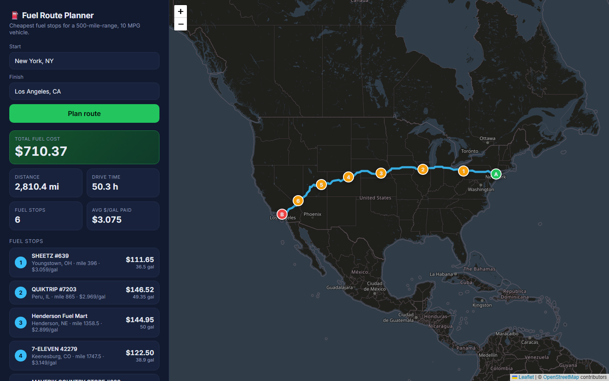

# ⛽ Fuel Route Planner API



A Django 6 API that takes a start and finish location in the USA and returns:

- the driving route, as GeoJSON plus an interactive map page,
- the most cost-effective fuel stops along it, for a vehicle with a **500-mile range** at **10 MPG**,
- the **total money spent on fuel**.

It makes **one routing call per trip**. Geocoding and station lookup happen offline, and repeat requests are served from cache.

**Live demo:**
- Map: <https://route-planner-ivory.vercel.app/map/?start=New%20York,%20NY&finish=Los%20Angeles,%20CA>
- API: <https://route-planner-ivory.vercel.app/api/v1/route/?start=Chicago,%20IL&finish=Houston,%20TX>

The demo runs on Vercel's free tier, so the first request after an idle period can take a few seconds.

| | |
|---|---|
| Framework | Django 6.1 + Django REST Framework, Python 3.12+ |
| Routing | [OSRM public API](https://project-osrm.org/) (free, no key, OpenStreetMap data) |
| Map | Leaflet + OpenStreetMap tiles (`/map/`) and GeoJSON in every response |
| Geocoding | Offline, using the US Census Gazetteer (public domain), built once into `data/*.csv` |
| Speed | ~0.3–0.7 s uncached (almost all of it is the single OSRM call; planning itself takes ~20–60 ms), ~5 ms cached |

---

## Quick start

```bash
python -m venv .venv
.venv\Scripts\activate          # Windows  (source .venv/bin/activate on macOS/Linux)
pip install -r requirements.txt
python manage.py runserver
```

- API: <http://127.0.0.1:8000/api/v1/route/?start=New York, NY&finish=Los Angeles, CA>
- Map UI: <http://127.0.0.1:8000/map/?start=New York, NY&finish=Los Angeles, CA>
- Tests: `python manage.py test planner`
- Postman: import `postman_collection.json`

No database, migrations or API keys are needed.

---

## API

### `GET /api/v1/route/` or `POST /api/v1/route/`

| Field | Type | Required | Notes |
|---|---|---|---|
| `start` | string | yes | `"City, ST"`, `"City, State"` or `"lat,lon"` |
| `finish` | string | yes | same formats |
| `mode` | `balanced` \| `cheapest` | no | default `balanced` (see "How stops are chosen") |
| `start_fuel_gallons` | number 0–50 | no | fuel in the tank at departure; default is a full tank (50 gal) |

```bash
curl -X POST http://127.0.0.1:8000/api/v1/route/ \
  -H "Content-Type: application/json" \
  -d '{"start": "Chicago, IL", "finish": "Houston, TX"}'
```

Example response (trimmed):

```json
{
  "start":  {"query": "New York, NY", "resolved": "New York city, NY", "lat": 40.66271, "lon": -73.93868},
  "finish": {"query": "Los Angeles, CA", "resolved": "Los Angeles city, CA", "lat": 34.01939, "lon": -118.41082},
  "mode": "balanced",
  "route": {"distance_miles": 2810.4, "duration_hours": 50.3},
  "vehicle": {"range_miles": 500, "mpg": 10, "tank_gallons": 50, "start_fuel_gallons": 50},
  "fuel_stops": [
    {
      "stop": 1, "mile_marker": 396.0, "off_route_miles": 3.8, "gallons": 36.5, "cost": 111.65,
      "station": {"id": 72445, "name": "SHEETZ #639", "address": "I-80 Exit 223",
                  "city": "Youngstown", "state": "OH", "lat": 41.0991, "lon": -80.6459, "price_per_gallon": 3.059}
    }
  ],
  "summary": {
    "total_fuel_cost": 710.37,
    "gallons_purchased": 231.04,
    "gallons_used": 281.04,
    "trip_fuel_cost": 864.1,
    "avg_price_paid": 3.075,
    "num_stops": 6,
    "stations_on_route": 341
  },
  "map": {
    "url": "/map/?start=New+York%2C+NY&finish=Los+Angeles%2C+CA",
    "geojson": {"type": "FeatureCollection", "features": ["route LineString, start/finish and stop Points"]}
  },
  "meta": {"cached": false, "routing_api_calls": 1, "elapsed_ms": 699.6, "routing_ms": 685.7, "compute_ms": 13.9}
}
```

- `total_fuel_cost` is the money spent at the recommended stops. The vehicle leaves with the tank you specify, full by default.
- `trip_fuel_cost` is every gallon burned on the trip, valued at the average price paid. Use it if you want the full fuel cost of the trip, including the starting tank.
- `map.geojson` can be pasted straight into <https://geojson.io>. `map.url` opens the interactive map.

Errors return `{"error": "<kind>", "detail": "..."}`:

| Status | `error` | When |
|---|---|---|
| 400 | DRF field errors / `invalid_location` | missing fields, a location outside the USA, or an unknown city |
| 422 | `no_fuel_in_range` | a stretch of the route is longer than 500 mi with no station |
| 502 | `routing_failed` | OSRM is unavailable, or no drivable route exists |

### `GET /api/v1/places/?q=dal&limit=8`

City suggestions for the start and finish fields, used by the map's autocomplete. The search runs offline against the Census place list and takes under 1 ms.

- Matches city names that start with the text typed. Adding a state narrows the list, e.g. `Dallas, T` or `chicago, illinois`.
- The ~200 largest US cities rank first, then other places by size.
- Every suggested label can be passed straight to `start` or `finish`.

```json
{"query": "dal", "results": [{"label": "Dallas, TX", "city": "Dallas", "state": "TX", "lat": 32.79333, "lon": -96.76651}]}
```

---

## How it works

```
request ──► resolve start/finish offline (Census gazetteer, in memory)    0 API calls
        ──► OSRM /route (overview=full, GeoJSON)                           1 API call (cached 24h)
        ──► corridor match: stations within 5 mi of the route              KD-tree, ~1 ms
        ──► optimise stops (DP)                                            ~20–60 ms
        ──► JSON + GeoJSON (+ cached result)
```

### 1. Data preparation (offline, once)
The fuel price sheet only has City and State. `scripts/build_datasets.py` geocodes every US station against the US Census Gazetteer and writes `data/stations.csv`:

- 6,626 unique US stations, of which **6,452 (97.4%) are geocoded**. The rest are tiny unincorporated places that aren't in the gazetteer.
- Canadian rows are dropped, since the trip must be in the USA.
- When a truck stop appears more than once in the sheet, only its cheapest price is kept.

The same script writes `data/us_places.csv`. The API uses it to resolve `start` and `finish` without calling a geocoding service. The result is zero runtime geocoding calls and no rate limits.

### 2. Corridor matching
The route polyline is resampled every 0.5 mi and loaded into a `scipy` KD-tree on unit-sphere coordinates. Every station inside the route's bounding box is matched to its nearest point on the route in one vectorised query. That gives each station a **mile marker** and an **off-route distance**. Stations within `CORRIDOR_MILES` (default 5) are candidates.

### 3. How stops are chosen
This is the classic gas-station problem. The DP follows Khuller, Malekian & Mestre, *"To fill or not to fill"* (ACM TALG 2011). It rests on one result: for a fixed sequence of stops, an optimal driver at each stop either:

- **buys just enough to reach the next stop**, if fuel there isn't more expensive, or
- **fills the tank**, if the next stop's fuel is more expensive.

So the fuel level when arriving at a stop can only take O(n·w) values. A DP over those states finds the exact optimum in O(n·w²), fully vectorised with numpy.

- **`mode=cheapest`** minimises fuel cost only. Its result matches the provably optimal greedy algorithm, and that is checked against 200 random routes in the tests.
- **`mode=balanced`** (the default) minimises `fuel cost + $5 × stops`. A pure cost optimiser will stop to buy one gallon to save one cent. The penalty removes those micro-stops. New York → Los Angeles drops from 15 stops to 6 for about $5 more.

### 4. Speed
- Stations and places are loaded into numpy arrays once, at startup in `AppConfig.ready()`. Requests never touch disk or a database.
- There is exactly one OSRM call per unique trip. A shared HTTP session gives keep-alive and retries. Routes and full results are cached (LocMem; swap in Redis for multiple processes).
- GZip middleware applies. The route line is thinned to about one point per mile before it is returned.

---

## Project layout

```
config/                 Django settings & root URLs
planner/
  datasets.py           in-memory station store + offline place geocoder
  routing.py            OSRM client (1 call, cached, retries, timeouts)
  geo.py                vectorised geometry helpers
  optimizer.py          DP fuel-stop optimiser (pure, framework-free)
  services.py           orchestration: geocode → route → corridor → optimise → JSON
  serializers.py        request validation
  views.py, urls.py     API + map page
  templates/planner/map.html   Leaflet UI
  tests/                optimiser property tests, API tests (OSRM mocked)
data/                   source spreadsheet + generated stations/places CSVs
scripts/build_datasets.py
postman_collection.json
```

## Configuration (env vars)

| Variable | Default | |
|---|---|---|
| `OSRM_URL` | `https://router.project-osrm.org` | point it at a self-hosted OSRM for production |
| `OSRM_TIMEOUT_S` | `15` | |
| `CORRIDOR_MILES` | `5` | how far off the route a station may be |
| `STOP_PENALTY_USD` | `5` | the per-stop cost used by `balanced` mode |
| `DJANGO_DEBUG`, `DJANGO_SECRET_KEY`, `DJANGO_ALLOWED_HOSTS` | | standard |

## Rebuilding the datasets

```bash
pip install -r requirements-dev.txt
# download 2024_Gaz_place_national.zip and 2024_Gaz_cousubs_national.zip from census.gov and unzip them
python scripts/build_datasets.py --prices data/fuel-prices-for-be-assessment.xlsx \
  --places 2024_Gaz_place_national.txt --cousubs 2024_Gaz_cousubs_national.txt
```

## Assumptions and trade-offs

- Stations are located at their city's centroid, because the sheet has no coordinates. A station's off-route distance is reported but does not count against the vehicle's range.
- The default start is a full tank. Pass `start_fuel_gallons` to change it.
- The public OSRM demo server is fine for an assessment. In production, use a self-hosted OSRM or a paid provider, and Redis for the cache.
